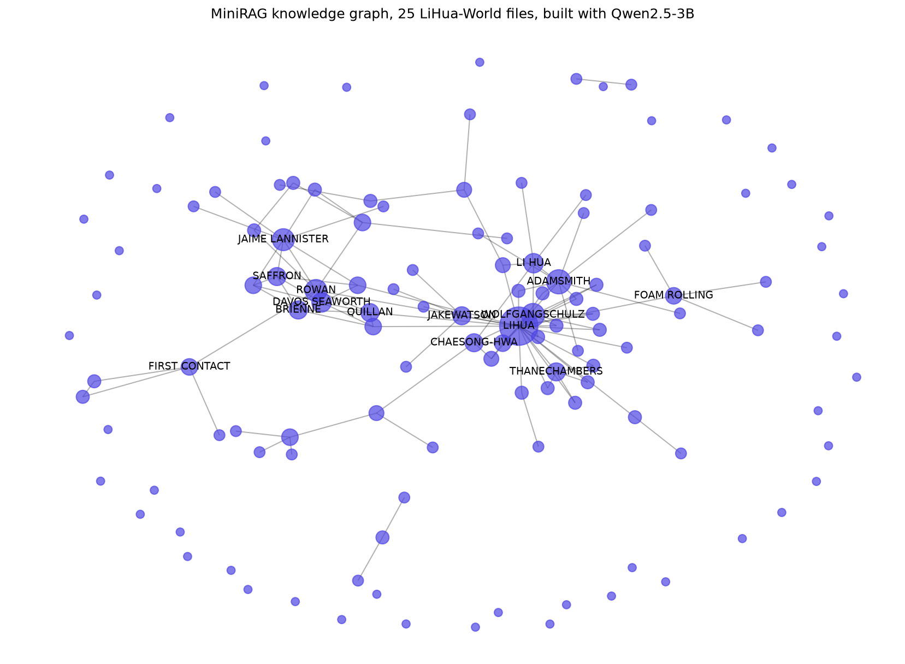

# MiniRAG Experiments

Reproducing and extending MiniRAG (ACL 2026), a graph-based RAG framework, using local LLMs through Ollama.

## Setup notes

- Python 3.14 couldn't build some dependencies (graspologic/gensim), so the project runs on Python 3.12.
- The PyPI package `minirag-hku` had an import bug, so I installed MiniRAG directly from GitHub.

## Findings

- Indexed a 5-file subset of LiHua-World: 45 nodes, 63 edges.
- llama3.2 couldn't follow MiniRAG's keyword extraction format in "mini" query mode, so querying uses Qwen2.5-3B.
- First query ("What does LiHua do for work?"): MiniRAG found LiHua's band activity through the graph; naive RAG found nothing relevant. Neither found a job, since the 5-file subset doesn't mention one.
- Indexed 25 files: 218 nodes but only 41 edges. llama3.2 extracted many entities but few relationships, which gives MiniRAG a sparse graph to work with.

## Experiment 1: MiniRAG vs naive RAG (25 files, 12 questions)

Setup: 25 files from LiHua-World, indexed with llama3.2, queried with Qwen2.5-3B, embeddings with nomic-embed-text. 12 questions written from the indexed files: 7 single-fact questions and 5 that need information from several files. Full answers are in `results/comparison.json`.

| Method | Correct | Partial | Wrong |
|---|---|---|---|
| MiniRAG | 0 | 1 | 11 |
| Naive RAG | 1 | 2 | 9 |

In this setup, MiniRAG did not beat naive RAG, which is the opposite of the paper's result.

### Observations

- MiniRAG's answers kept mentioning the same topics (rent, workouts, the neighborhood) whatever the question. LiHua appears in every file, so the "LiHua" keyword likely pulls in the same chunks every time.
- Naive RAG sometimes retrieved the right fact but used it in the wrong answer (Sekiro appeared in the rent question, jazz fusion in the band-ideas question), so the small model struggled to connect the retrieved context to the question.
- The graph was sparse (218 nodes, 41 edges), which gives MiniRAG few connections to follow, and following connections is its main advantage.

### Limitations

- Only 25 of the dataset's files, because indexing with a local model on a laptop is slow.
- 12 questions, scored by hand.
- Small local models, not the exact setup from the paper.

### Next

Re-index with Qwen2.5-3B instead of llama3.2 to test whether a denser graph improves MiniRAG.

## Experiment 2: denser graph with Qwen2.5-3B

Same 25 files and 12 questions, but the graph was built with Qwen2.5-3B instead of llama3.2.

| Indexing model | Nodes | Edges |
|---|---|---|
| llama3.2 | 218 | 41 |
| qwen2.5:3b | 124 | 111 |

| Experiment | MiniRAG (correct / partial / wrong) | Naive RAG (correct / partial / wrong) |
|---|---|---|
| 1: llama3.2 graph | 0 / 1 / 11 | 1 / 2 / 9 |
| 2: qwen2.5 graph | 3 / 1 / 8 | 1 / 2 / 9 |

### Observations

- Naive RAG doesn't use the graph and its score didn't change, so it acts as a control. MiniRAG improved, which suggests the denser graph caused the gain.
- All three of MiniRAG's correct answers were questions that need information from several conversations, which is what the graph is designed for.
- Single-fact questions failed for both methods in both experiments (0 of 7). Every file mentions LiHua, so retrieval may bring back too many unrelated chunks.
- Naive RAG sometimes made up content, for example inventing a whole conversation for the FC Barcelona question.
- With only 12 questions, this is a direction, not a conclusive result.

- LiHua is the central hub, connected to the people he talks to most (Wolfgang Schulz, Adam Smith, Jake Watson, ChaeSong-hwa).
- The graph separates LiHua's own conversations from an unrelated group chat about Game of Thrones.
- "LIHUA" and "LI HUA" were extracted as two different entities, so LiHua's connections are split across two nodes. Better entity matching could improve retrieval.
- Many entities have no connections at all (the outer ring), even with the denser graph.